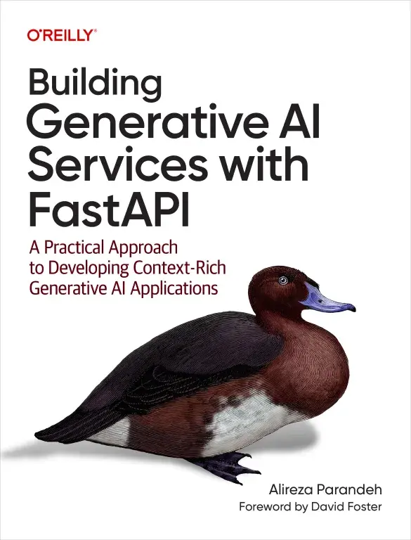

# Production Readiness Auditor (Based on BGAI Book)

A Claude Code skill that runs a structured production-readiness audit on a FastAPI + LLM/Generative AI codebase. It is grounded in *[Building Generative AI Services with FastAPI* (Ali Parandeh, O'Reilly, 2025)](https://buildinggenai.com).

[](https://buildinggenai.com)

The skill runs **inside your repository** from a coding agent. It walks the code itself, grades seven areas one at a time as Pass / Partial / Fail with book-grounded feedback, and only asks you questions the code cannot answer. At the end it writes a timestamped audit report to the repo root.

## What it checks

Seven areas, each mapped to chapters of the book:

| Area                                           | Chapter  |
|------------------------------------------------|----------|
| 1. Modular project architecture (Onion design) | 2        |
| 2. FastAPI routing and API design              | 2, 4     |
| 3. LLM integration and real-time streaming     | 3, 5, 6  |
| 4. Async concurrency for GenAI                 | 5        |
| 5. LLM security and optimisation               | 8, 9, 10 |
| 6. Tests and behavioural testing               | 11       |
| 7. Docker and container security               | 9, 12    |

Feedback is grounded first in the reference files under `references/`, optionally enriched by the O'Reilly MCP (see below), and falls back to built-in checks where neither covers a point.

## Requirements

- [Claude Code](https://docs.claude.com/en/docs/claude-code) installed.
- A FastAPI + LLM/GenAI repository to audit.
- Optional: access to the O'Reilly MCP for live book-grounded recommendations. Without it, the skill uses `references/oreilly-fallback.md`.

## Installation

### As a plugin (recommended)

Inside Claude Code, run:

```bash
/plugin install production-readiness-auditor --marketplace Ali-Parandeh/production-readiness-auditor
```

That needs Claude Code 2.1.275 or later. On older versions, add the marketplace first and then install:

```bash
/plugin marketplace add Ali-Parandeh/production-readiness-auditor
/plugin install production-readiness-auditor@buildinggenai
```

You get updates with `/plugin marketplace update buildinggenai`.

### As a standalone skill

If you'd rather not use plugins, clone the repo into a Claude Code skills directory. The folder needs `SKILL.md` at its top level.

**Personal (available in every project):**

```bash
git clone https://github.com/Ali-Parandeh/production-readiness-auditor.git ~/.claude/skills/production-readiness-auditor
```

**Project-scoped (checked in with a specific repo):**

```bash
git clone https://github.com/Ali-Parandeh/production-readiness-auditor.git .claude/skills/production-readiness-auditor
```

On Windows PowerShell, swap `~/.claude` for `$env:USERPROFILE\.claude`.

Restart Claude Code (or start a new session) so it picks the skill up. Don't install it both ways, or the skill shows up twice.

## Usage

From inside the repo you want to audit, ask Claude Code or your agent harness to run it, for example:

- "Is my codebase production-ready?"
- "Run a FastAPI production audit"
- "Review this GenAI service for deployment"

Or invoke it directly. Installed as a plugin:

```
/production-readiness-auditor:production-readiness-auditor
```

Installed as a standalone skill:

```
/production-readiness-auditor
```

It works through the seven areas in order, reports each before moving on, then gives a final overview with a summary table, the top three urgent fixes, and consolidated reading. A report file named `PRODUCTION_READINESS_AUDIT-{YYYY-MM-DD-HHMM}.md` is written to the repo root when it finishes.

## Setting up the O'Reilly MCP (optional)

Connecting the O'Reilly MCP lets the skill pull current editions, links, and (where your account supports it) book passages, instead of the static fallback list. Without it everything still works, just with the bundled recommendations.

The MCP is an HTTP server:

- **Endpoint:** `https://api.oreilly.com/api/content-discovery/v1/mcp/`
- **Docs:** https://learning.oreilly.com/apidocs/mcp/content/

Add it to Claude Code:

```bash
claude mcp add oreilly --transport http https://api.oreilly.com/api/content-discovery/v1/mcp/
```

Access requires an O'Reilly learning account/subscription, and the endpoint expects authentication. Check the docs above for the current auth method (for example, an `Authorization` header) and pass it when registering the server, for example:

```bash
claude mcp add oreilly --transport http https://api.oreilly.com/api/content-discovery/v1/mcp/ --header "Authorization: Bearer YOUR_TOKEN"
```

Keep the token out of version control. Do not paste it into `SKILL.md` or any tracked file. Once connected, verify with:

```bash
claude mcp list
```

The skill auto-detects the MCP. If tools like `search_oreilly_content` or `ask_oreilly_experts` are present it uses them; otherwise it degrades cleanly to `references/oreilly-fallback.md`.

When it's connected, the skill sends short topic queries to O'Reilly (for example "Docker non-root container security"). It does not send your source code, file names, config or anything that identifies your project. See [PRIVACY.md](PRIVACY.md).

## Troubleshooting

**The skill doesn't start when I ask for an audit.** Check it's installed: run `/plugin` and look for `production-readiness-auditor`, or check the folder exists under `~/.claude/skills/` if you cloned it. Start a new session after installing. If it still doesn't trigger, call it directly with the slash command under Usage.

**It shows up twice.** You've installed it as a plugin and as a cloned skill. Remove one.

**It says the repo isn't a FastAPI + LLM service.** The skill is built for that stack. It will still grade what it can, but areas like streaming and LLM security won't apply to a plain web app or a non-FastAPI project.

**The O'Reilly MCP isn't being used.** Run `claude mcp list` and check `oreilly` is listed and connected. An auth failure usually means the token is missing or expired. The audit still works without it, using the bundled references.

**No report file appeared.** The report is written to the repository root at the end of the full audit. If you stopped partway through, ask Claude to write the report for the areas covered so far.

**Something else.** Open an issue at https://github.com/Ali-Parandeh/production-readiness-auditor/issues. For security problems, see [SECURITY.md](SECURITY.md) instead.

## Repository layout

```
.claude-plugin/
  marketplace.json           plugin marketplace manifest
  plugin.json                plugin manifest
SKILL.md                     the skill definition and the seven-area audit loop
PRIVACY.md                   privacy policy
SECURITY.md                  how to report security issues
references/
  ch02-architecture.md       grounding for areas 1 and 2
  ch05-async.md              grounding for areas 3 and 4
  ch06-streaming.md          grounding for area 3
  ch08-auth.md               grounding for area 5
  ch09-security.md           grounding for area 5
  ch10-optimisation.md       grounding for area 5
  ch11-testing.md            grounding for area 6
  ch12-deployment.md         grounding for area 7
  oreilly-fallback.md        recommendations used when the MCP is not connected
```

## Licence

APACHE 2.0. See [LICENSE](LICENSE).
